# TP 6 : Service Banque en CORBA

**Étudiante :** Hana Ben Hmad

**Classe :** LSI3

**Matière :** Développement d'applications réparties

**Activité :** Implémenter des communications client-serveur via CORBA

L'application est une banque répartie : un serveur CORBA gère les comptes bancaires (code + solde) et un client appelle à distance les opérations du service : créer un compte, verser, retirer, consulter un compte, lister les comptes et convertir un montant d'euros en dinars tunisiens.

## Structure du dépôt

```
.
├── README.md
├── captures/                    (imprimés écran)
├── TP6_CorbaBanque_Server/
│   └── src/
│       ├── Banque.idl
│       ├── jndi.properties
│       ├── corbaBanque/         (code généré par idlj)
│       ├── service/BanqueImpl.java
│       └── corbaServer/BanqueServer.java
└── TP6_CorbaBanque_Client/
    └── src/
        ├── Banque.idl
        ├── jndi.properties
        ├── corbaBanque/         (code généré par idlj)
        └── corbaClient/BanqueClient.java
```

## Étape 1 : Préparation de l'espace de travail

### 1.1 Dossier de travail

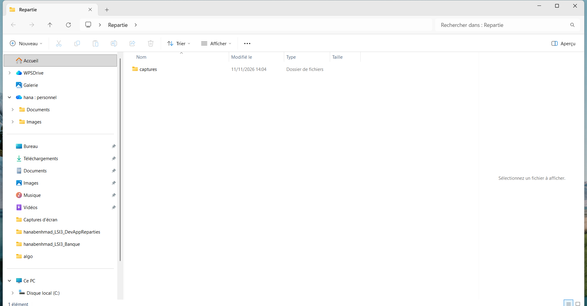

### 1.2 Vérification de l'environnement (JDK 8)

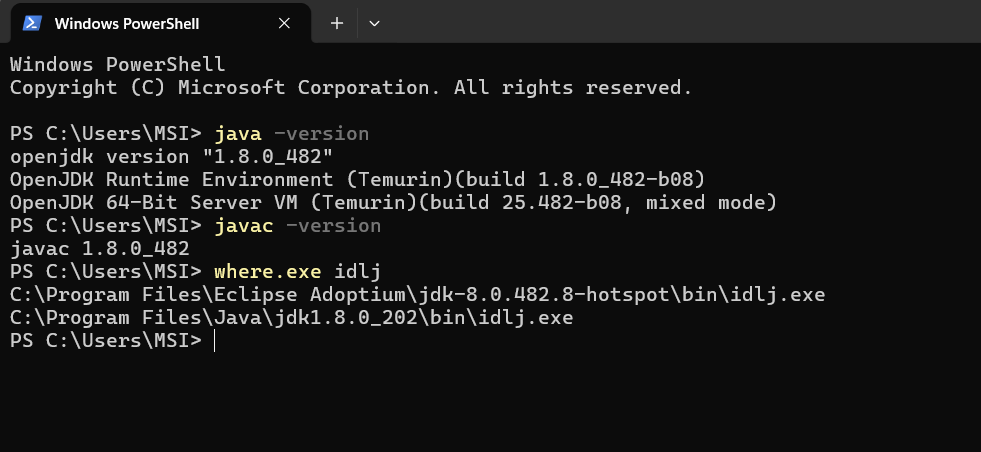

**Synthèse :** l'espace de travail contient un sous-dossier `captures` pour les imprimés écran. La vérification confirme que `java` et `javac` sont en version 1.8.0_482 (Temurin). L'outil `idlj`, nécessaire pour générer le code CORBA à partir du fichier IDL, est bien disponible dans le JDK 8.

## Étape 2 : Développement du serveur

### 2.1 Création du projet serveur

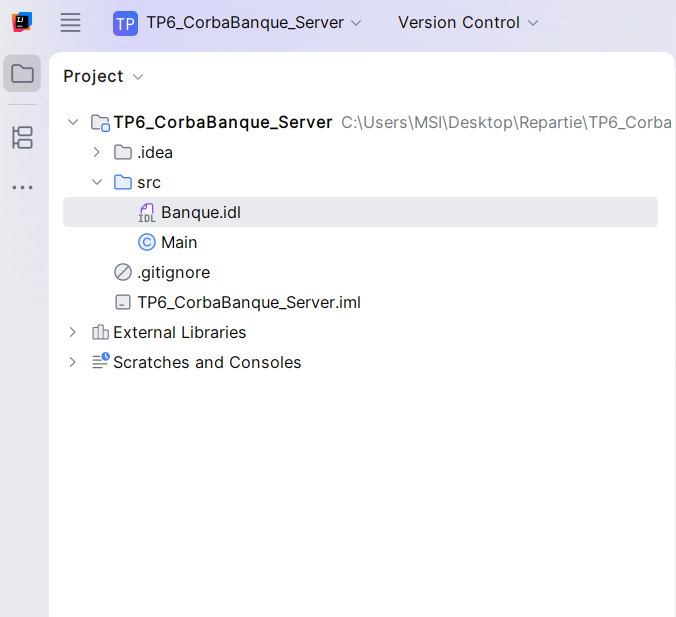

Le projet Java `TP6_CorbaBanque_Server` est créé avec le JDK 1.8.

### 2.2 Interface IDL

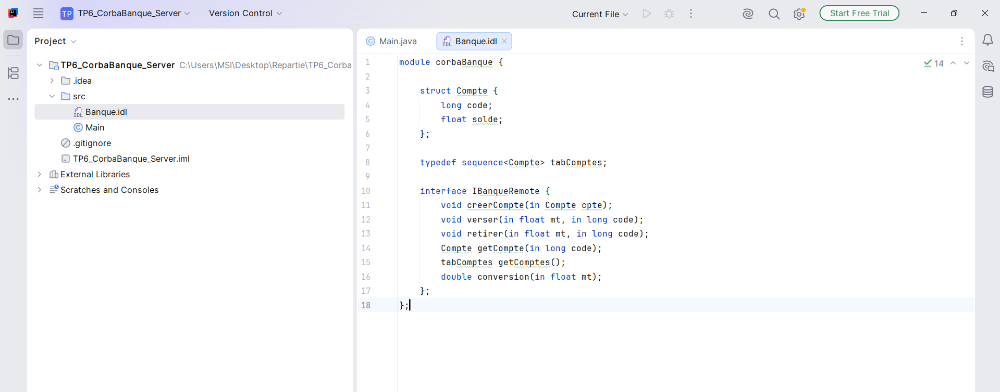

Le fichier `Banque.idl` déclare le module `corbaBanque`, la structure `Compte` (code : long, solde : float), l'alias `tabComptes` (séquence de comptes) et l'interface `IBanqueRemote` avec les méthodes `creerCompte`, `verser`, `retirer`, `getCompte`, `getComptes` et `conversion`.

### 2.3 Compilation de l'IDL

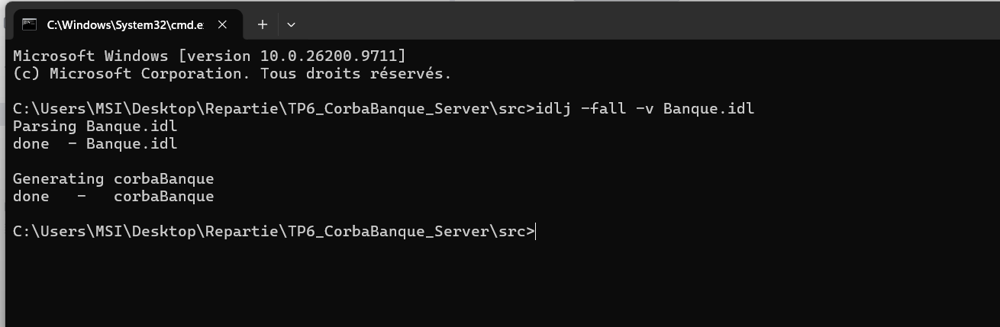

La commande `idlj -fall -v Banque.idl` génère le code Java CORBA (stub, skeleton POA, helpers, holders).

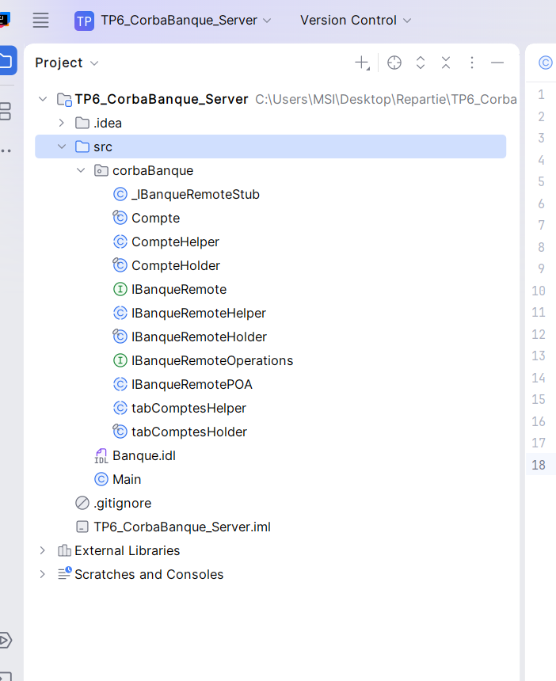

Le dossier `corbaBanque` contient les 11 fichiers générés, dont `IBanqueRemotePOA`, `IBanqueRemoteOperations` et `_IBanqueRemoteStub`.

### 2.4 Implémentation du servant

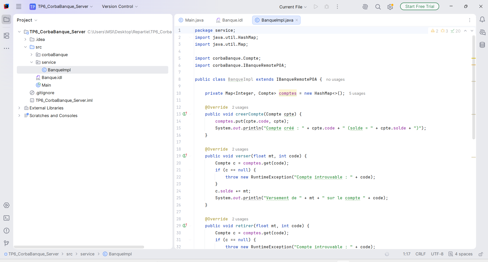

La classe `BanqueImpl` (package `service`) hérite de `IBanqueRemotePOA`. Les comptes sont stockés dans une `HashMap`. Le retrait refuse un solde insuffisant et la conversion utilise le taux 1 € = 3,4 DT.

### 2.5 Configuration JNDI

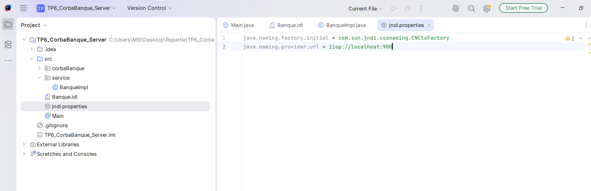

Le fichier `jndi.properties` indique la fabrique de contexte `com.sun.jndi.cosnaming.CNCtxFactory` et l'adresse de l'annuaire de noms `iiop://localhost:900`.

### 2.6 Serveur CORBA

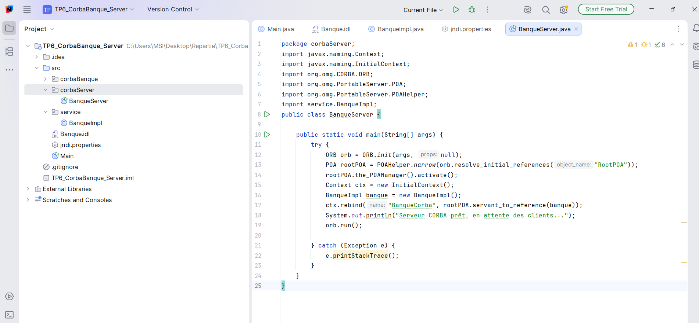

La classe `BanqueServer` (package `corbaServer`) initialise l'ORB, récupère le RootPOA et active le POAManager, configure l'annuaire JNDI, crée le servant `BanqueImpl`, enregistre sa référence sous le nom `BanqueCorba`, puis met l'ORB en attente des requêtes.

**Synthèse :** le serveur est défini par son contrat IDL, dont le code est généré automatiquement par `idlj`. Le servant implémente la logique métier et le serveur l'enregistre dans l'annuaire de noms pour le rendre accessible aux clients.

## Étape 3 : Développement du client

### 3.1 Création du projet client

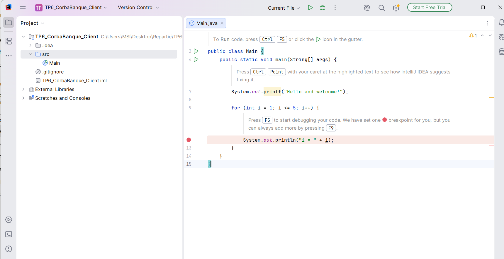

### 3.2 Préparation du client

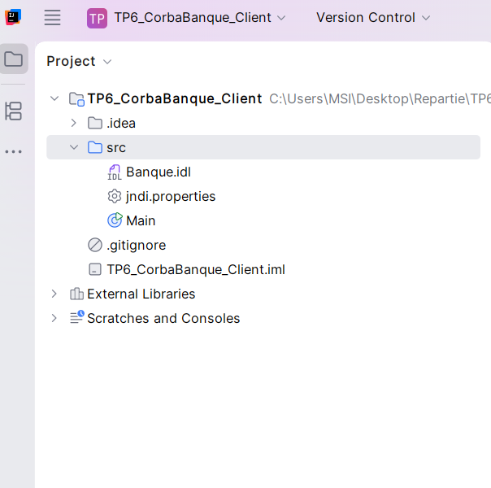

Les fichiers `Banque.idl` et `jndi.properties` sont copiés dans `TP6_CorbaBanque_Client/src`.

### 3.3 Compilation de l'IDL côté client

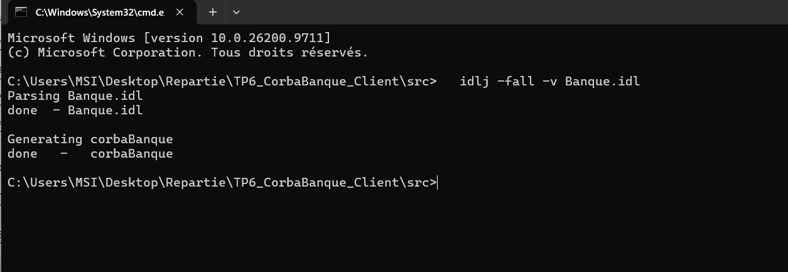

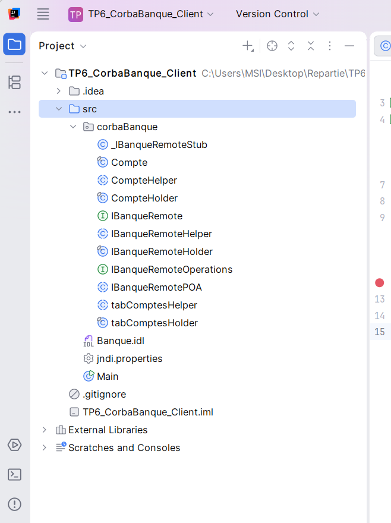

### 3.4 Client CORBA

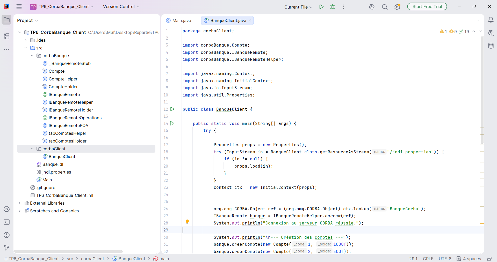

La classe `BanqueClient` (package `corbaClient`) charge les propriétés JNDI, récupère la référence de l'objet distant via `lookup("BanqueCorba")`, la convertit en `IBanqueRemote` avec `IBanqueRemoteHelper.narrow` pour obtenir le stub, puis teste chaque méthode du service.

**Synthèse :** le client n'a besoin que du contrat IDL. Le stub généré masque la communication réseau : les appels distants s'écrivent comme des appels de méthodes locales.

## Étape 4 : Exécution de l'application

L'exécution respecte l'ordre d'initialisation : annuaire, puis serveur, puis client.

### 4.1 Lancement de l'annuaire de noms

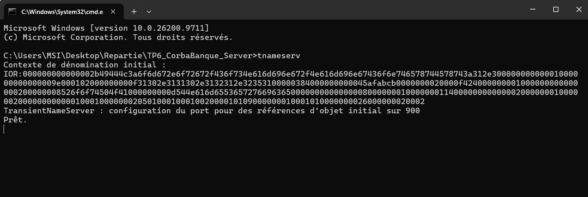

Le service de noms `tnameserv` écoute sur le port 900 (message Prêt.).

### 4.2 Lancement du serveur

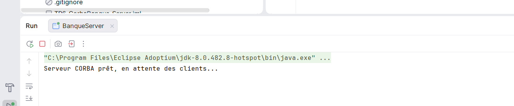

Le serveur affiche `Serveur CORBA prêt, en attente des clients...`.

### 4.3 Lancement du client

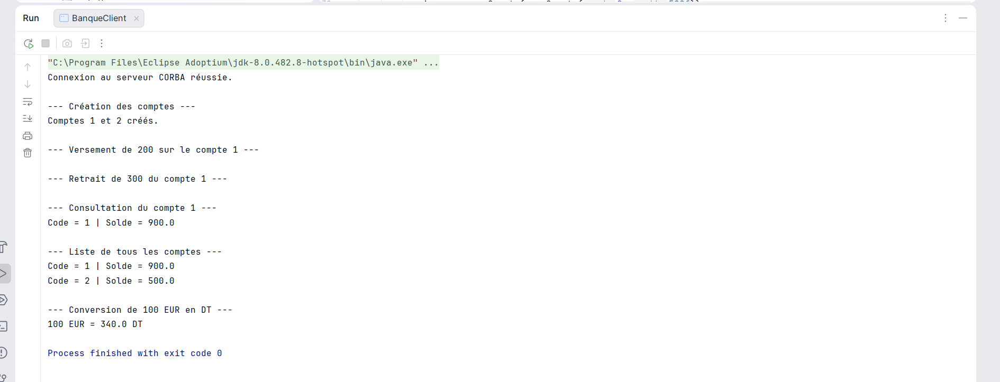

Le client crée deux comptes, verse 200 sur le compte 1, retire 300, consulte le compte 1 (solde 900.0), liste les comptes et convertit 100 € en 340.0 DT.

### 4.4 Journal du serveur

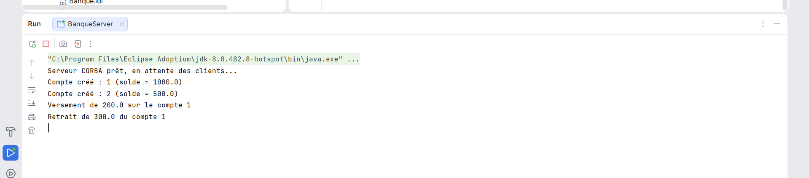

Le serveur affiche les opérations reçues du client (création des comptes, versement, retrait), ce qui confirme que les appels sont bien exécutés à distance.

**Synthèse :** les six opérations du service bancaire fonctionnent via CORBA. Le projet doit être compilé et exécuté avec le même JDK 8 (Temurin 1.8.0_482) que celui qui a fourni `idlj`, car le code généré dépend de cette version.

## Étape 5 : Dépôt des livrables

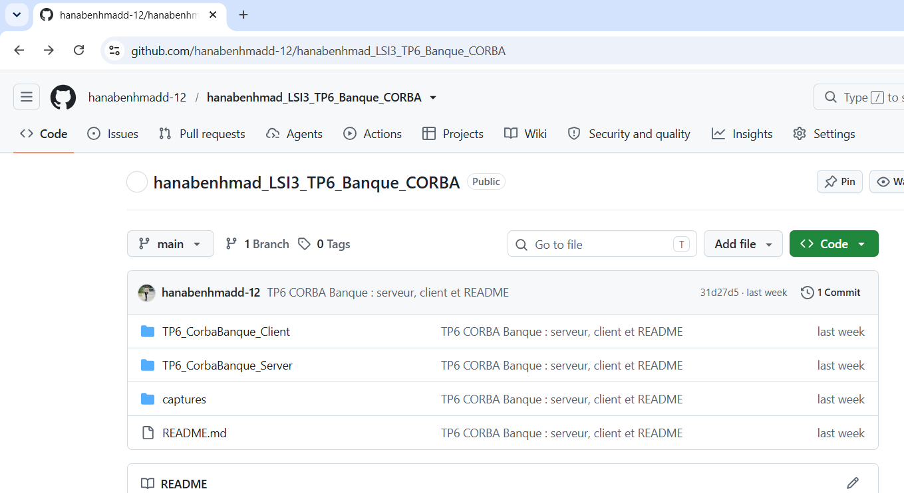

Dépôt GitHub : https://github.com/hanabenhmadd-12/hanabenhmad_LSI3_TP6_Banque_CORBA

## Conclusion

Ce TP a permis de mettre en oeuvre une application client-serveur avec le middleware CORBA : définition du contrat en IDL, génération du code avec idlj, implémentation du servant, enregistrement dans l'annuaire de noms via JNDI, puis appel des méthodes distantes depuis un client Java.
